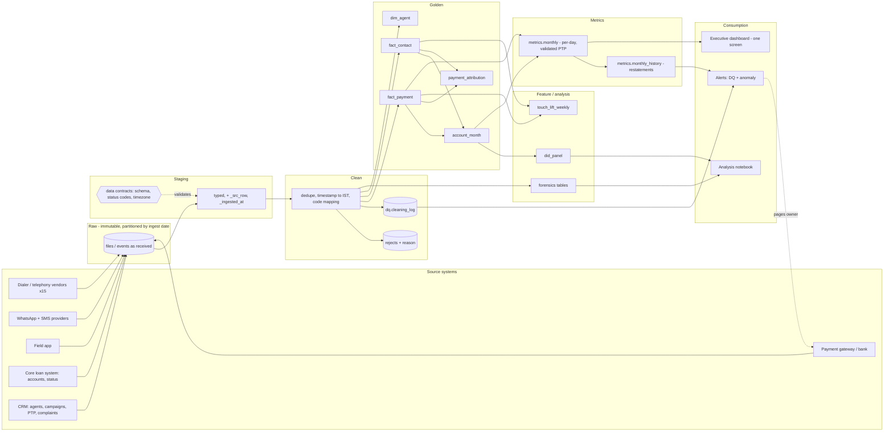
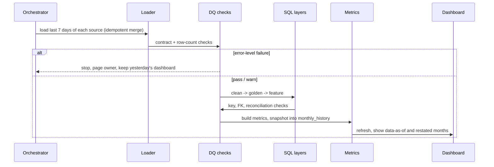

# Architecture diagram

Rendered natively by GitHub / VS Code / most markdown viewers.



## Daily run



## How to run the implemented part

```
python pipeline/run_pipeline.py --export     # raw CSV -> stg -> clean -> golden -> metrics -> forensics -> analysis
python pipeline/build_notebook.py            # executes the notebook
python pipeline/build_dashboard.py           # writes dashboard/index.html
```
